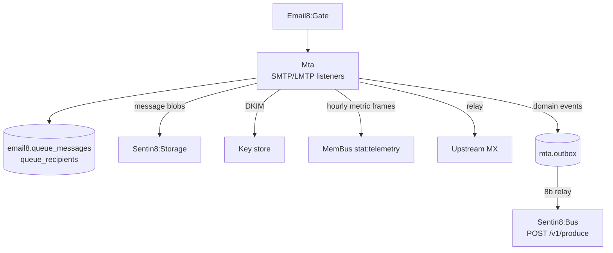

# Sentin8 Email8:Mta - SMTP/LMTP Transfer Engine

## 1. Summary

Email8:Mta is the mail transfer engine: SMTP/LMTP protocol handling,
the durable delivery queue (message + recipient state machine with
scheduled retries), DKIM signing, DMARC/TLS-RPT report generation,
and outbound relay.

## 2. Architecture

## 3. Key Traits

- Queue state machine: recipient status transitions with retry
  backoff; the queue IS the retry contract.
- Telemetry (SDD §2.6): queue depth, latency, spam-rate frames
  publish on the shared MemBus `stat:telemetry` path -
  fire-and-forget, no stat client.
- Event emission (OUTBOX-EMAIL8, architecture-principles §6.7): domain
  events (`email8:mta:*`) insert into the LOCAL `mta.outbox` in the same
  transaction as the domain change; the shell's 8b relay drains them to
  Bus `POST /v1/produce` (idempotency_key = row id; consumers dedupe).
- Audit journal (AUDJOUR-1, architecture-principles §6.8): the
  `mta.audit_journal` leaf-schema table (migration v4 - the 15-column
  `sentin8_audit::audit_journal_sql` contract) is drained to Sys
  `POST /v1/audit` by the shell's boot-8c pusher, presenting the
  `mta-audit` workload certificate (`sentin8:sys:audit:write`).
- M2M: certificate identity (CERTFREE-4V) - the MTA's own workload cert
  presents in the TLS handshake for Storage and Store internal calls; no
  secrets in tables.

See the vertical group docs (`email8/README.md`) for the plane
overview.

---

**Architecture & Design:** email8:mta and its underlying concepts were designed by [Hamid Jahanzad](https://www.linkedin.com/in/hamidjahanzad/).
